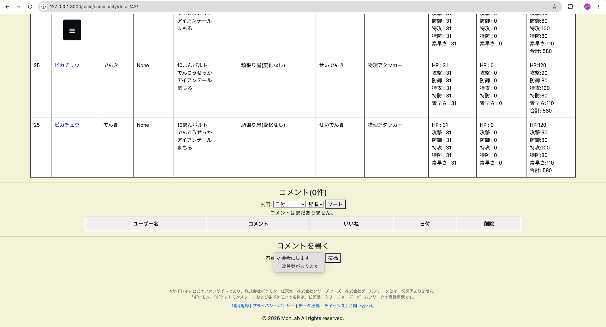

# 二次的コンテンツのリリース化において気をつけること

## 1. はじめに

お疲れ様です、システム部の西浦です！ ourlyにも投稿していますが、これまで個人開発でポケモンアプリを作っており、社内の皆さんからいただいた意見を取り入れながら機能を実装してきました（個体値の提案、育成論、バトルシミュレーションなど）。  
目的は、将来的にリリースして収益を得ること、そして個人の実装スキルを上げることです。 
そこで、「有料サブスク」または「無料＋広告」での一般リリースについて、任天堂、(株)ポケモン、知財に詳しい弁護士に相談しました。本記事ではその結果を共有します。  
著作権や商標権の勉強になると思いますので、今後アプリのリリースを考えている方の参考になれば幸いです。

## 2. 前提

- Web アプリのみでの運用です（スマホアプリではありません）。
- 使用言語・技術：Python（Django）、HTML、CSS、JavaScript、PostgreSQL
- アイテムやポケモンの基本データ（タイプ、高さ・重さ、覚える技）：[GitHub](https://github.com/dayuTips/pokemon-data.json/tree/master) で公開されていた、他の方が作成したサイトのデータを利用しています。
- ポケモンの詳細データ（技の威力・分類・命中率など）：[PokeAPI](https://pokeapi.co/) を利用しています。
- 上記のデータをPostgreSQL(DB)にマイグレーション → ユーザーが検索 → DB を参照して画面に反映するという仕組みです。
- 各機能の詳細は [Google Drive](https://drive.google.com/drive/folders/11lf70qqIVhEVCndGJ6YODqMjMWvZ_lwb) に保存しています。

## 3. 結論

結論として、**リスクを判断できないため、リリースは保留**にしています。

- 任天堂からは、「(株)ポケモンにお問い合わせください」との回答でした。
- (株)ポケモンからは、「個人や法人を問わず、独自の事業は、特別に許諾したものを除き、弊社の著作物や商標利用に関する許諾は一切行なっておりません。万が一、ポケモンの諸権利を侵害していると判断した場合、法的措置の可能性がございますので、あらかじめ注意して下さい。」と**リリースして良いのか悪いのかどちらとも言えない曖昧な回答**でした。

この結果をもとに、知財に詳しい弁護士へメールで問い合わせたところ、以下の回答をいただきました。

> 「現時点ではリスクの大小を判断できません。一般論しかお伝えできません。詳細をお求めの場合は、依頼料として2〜3万円ほどいただきます。」

複数人の弁護士から伺った一般論は以下のとおりです。

1. 事実データが著作権侵害の要件を満たす可能性は低い
   - アイテム名やポケモン名のテキストデータや、数値データ（高さ・重さ、種族値など）は、営利目的ではなくユーザーの役に立つことが目的なので、リスクは下がる。
2. 有料を廃止して「無料＋広告」にしても、問題はなくならない
   - 広告収入がある以上、純粋な非営利活動とは言い難い。
3. アイテムや技の説明文は画面に出さない方がいい
   - ゲームと同じ説明文を画面に載せると、著作権侵害にあたるおそれがある。
4. 利用規約をつけた方がいい
   - ポケモンや任天堂とは無関係のファンサイトであることを明記する。また、データの取得元の詳細（ライセンス）も明記する。
5. 警告や削除申請があったときは、速やかな削除や公開停止を検討するべき
6. データ元のライセンスを確認するべき

## 4. リリースしたいという情熱だけでは法律には勝てない

リリースにあたってネックになるのは、**商標権**と**著作権**です。さらに、広告にも問題があります。 
(株)ポケモンは、すでに私が作ったアプリの存在を把握しているため、目をつけられている状態です。このままリリースすれば、「喧嘩を売っているのか」と受け取られかねません。  
また、権利者は権利侵害の有無にかかわらず、Google AdSense に申し立てを行うことができます。その結果、広告が停止されるリスクがあります。広告収入がなくなると運用費をまかなえず赤字になり、財布が持ちません。

さらに、ポケモンのデータを使ったサイトで広告収入を得ることは、本来(株)ポケモンや任天堂が得るはずの利益を奪っている状態とみなされる可能性があります。 そうなると、広告を停止して無料でリリースせざるを得なくなり、運用費がすべて自己負担となって赤字になります。

そして見落としがちなのが、**影響は個人だけにとどまらない**という点です。 もし訴えられた場合、個人だけでなく所属している会社にも影響が及ぶ可能性があります。 個人開発であっても、会社に迷惑をかけるリスクがあることを意識しておく必要があります。

## 5. 対処法

### 公開するデータの種類に注意する

- 二次的著作物としてリリースする場合、画像データの使用は NG です。
- 有料化は「事業」に該当するため NG です。
- 事実に基づくデータ（数値など）は OK です。
- ゲーム内に表示される技やアイテムの説明文を、そのままアプリの画面に載せるのは NG です（例：技を選んだときにゲームで出てくる説明文を、一字一句同じ形で表示する）。ゲームの説明文は文章そのものが著作物にあたる可能性があり、著作権侵害になるおそれがあるためです。

### データ元のライセンスを確認する

利用しているデータ元のライセンスは必ず把握しておきましょう。 たとえば「商用利用禁止」と書かれているにもかかわらずリリースし、権利者に見つかった場合は、訴訟などのトラブルに発展するおそれがあります。 私が使用した2つのデータ（GitHub、PokeAPI）では、下記の制約がありました。

#### ポケモンデータ（GitHub：[dayuTips/pokemon-data.json](https://github.com/dayuTips/pokemon-data.json)）

- ライセンス：[**MIT License**](https://github.com/dayuTips/pokemon-data.json/blob/master/LICENSE)
- できること：商用利用、改変、再配布、個人での利用
- 守ること：著作権表示とライセンス条文を残す
- 免責：何の保証もなく提供されており、利用によって損害が生じても作者は責任を負わない

#### PokeAPI（[PokeAPI/pokeapi](https://github.com/PokeAPI/pokeapi)）

- ライセンス：[**BSD 3-Clause License**](https://github.com/PokeAPI/pokeapi/blob/master/LICENSE.md)
- できること：商用利用、改変、再配布、個人での利用
- 守ること：
  - 著作権表示（© 2013–2023 Paul Hallett and PokéAPI contributors）、ライセンス条文、免責事項を残す
  - 書面での許可なく、PokéAPI や開発者の名前を自分のアプリの宣伝に使わない
- 免責：何の保証もなく提供されており、利用によって損害が生じても開発者は責任を負わない
- 注意書き：「Pokémon and Pokémon character names are trademarks of Nintendo.」（ポケモンおよびポケモンのキャラクター名は任天堂の商標です）と明記されている

#### ライセンスが「商用利用 OK」でも安心はできない

どちらのライセンスも商用利用を認めていますが、許可しているのは**データを作成した人が持つ権利の範囲だけ**です。 ポケモンの名前やゲーム内のデータに関する任天堂・(株)ポケモンの権利まで許可しているわけではありません。 PokeAPI が商標についての注意書きを入れているのも、そのためです。  
つまり、「データ元のライセンスが商用利用 OK だから、ポケモンアプリで収益化しても問題ない」とはならない点に注意が必要です。

### コメント機能に注意する

自由入力のコメント機能を設けると、投稿内容が誹謗中傷に該当した場合、投稿者だけでなくサイト管理者も訴えられる可能性があります。  
すでに実装済みですが、コメントをプルダウンによる選択式に限定することで、訴訟リスクを大きく下げることができます。

## 6. リリースを想定した準備・費用

今回はリリースを保留していますが、実際にリリースする場合に必要な準備と費用の目安をまとめます。

### VPS の契約

- 利用予定のサービス：ConoHa VPS、さくらの VPS、Xserver VPS などの国内 VPS を検討
- プラン：個人開発の小規模な Web アプリであれば、メモリ 1〜2GB 程度のプランで十分
- サーバ構成：Nginx（Web サーバ）＋ Gunicorn（アプリケーションサーバ）＋ PostgreSQL を VPS 上に構築し、Django アプリを動かす想定

### ドメイン取得・HTTPS 化

- ドメイン：お名前.com などのドメイン取得サービスで `.com` などのドメインを取得し、DNS で VPS の IP アドレスに向ける
- SSL 証明書：Let's Encrypt（Certbot）を使えば無料で HTTPS 化でき、証明書の自動更新も設定できる

### Django の設定（settings.py）

- `DEBUG = False` にする
- `ALLOWED_HOSTS` に VPS のドメイン・IP を設定する
- `SECRET_KEY` や DB のパスワードなどの秘密情報は環境変数に分け、GitHub に載せない
- `DATABASES` に VPS 上の PostgreSQL の接続情報（DB 名・ユーザー名・ホスト・ポート）を設定する
- `STATIC_ROOT` を設定し、`python manage.py collectstatic` で静的ファイルを集めて Nginx から配信する
- HTTPS 化に合わせて `CSRF_TRUSTED_ORIGINS`、`SECURE_SSL_REDIRECT`、`SESSION_COOKIE_SECURE`、`CSRF_COOKIE_SECURE` を設定する

### Google AdSense の登録

- 登録・審査の流れ：Google アカウントで AdSense に申し込む → サイトの URL を登録する → 発行されたコードをサイトの `<head>` に貼る → `ads.txt` を設置する → 審査（数日〜数週間かかることがある）
- 審査にはプライバシーポリシーのページが必要
- 審査では、オリジナルのコンテンツが十分にあるか、ポリシーに違反していないかが見られる。他者の著作物を無断で使ったコンテンツはポリシー違反となり、審査に通らない、または承認後に広告が停止される可能性がある

### 利用規約・プライバシーポリシー・免責事項の用意

- 利用規約：(株)ポケモンや任天堂とは無関係の非公式ファンサイトであること、データの取得元とそのライセンスを明記する
- プライバシーポリシー：Google AdSense やアクセス解析で Cookie を使用すること、取得する情報とその利用目的を明記する
- 免責事項：掲載データの正確性を保証しないこと、サイトの利用によって生じた損害に責任を負わないことを明記する
- 問い合わせ窓口：権利者から警告や削除申請があった場合に、速やかに対応できる連絡先を用意する

### セキュリティ対策

- 不正アクセスへの備え
  - 最近、某証券会社などで不正アクセスの被害が相次ぎ、話題になっている
  - このアプリでもログイン機能がある以上、メールアドレスやパスワードが盗まれるリスクがある
  - 対策例：パスワードはハッシュ化して保存する（Django は標準でハッシュ化される）、二段階認証を導入する、ログイン試行回数を制限する
- bot によるアクセスへの備え
  - 対策例：bot によるアクセスを検知する、reCAPTCHA を導入する、アクセス数を制限する（レート制限）
- 個人情報を預かる以上、漏えいした場合は運営者の責任になる

### 運用費の目安

| 項目 | 月額 | 年額 |
|---|---|---|
| VPS（メモリ 1〜2GB） | 約 1,000円 | 約 12,000円 |
| ドメイン（`.com`） | 約 150円 | 約 1,800円 |
| SSL 証明書（Let's Encrypt） | 0円 | 0円 |
| その他（バックアップなど） | 約 300円 | 約 3,600円 |
| **合計** | **約 1,450円** | **約 17,400円** |

※ 金額は一般的な相場をもとにした目安です。サービスやプラン、キャンペーンによって変わります。

一見少額に見えますが、広告が停止されたり、広告なしの無料リリースを求められたりした場合、この費用はすべて自己負担になります。収益がないまま毎年約 1.7 万円を払い続けることになり、続けるほど赤字が積み上がっていきます。

さらに、この金額はあくまで利用者が少ない段階での目安です。ユーザー数やアクセス数が増えると今の VPS のプランでは足りなくなり、上位プランへのスケールアップや AWS などのクラウドへの移行が必要になる可能性があります。そうなると運用費はさらに増え、赤字の幅も大きくなります。

## 7. 学んだこと

### 作り始める前に権利関係を確認する

今回は機能をある程度作り込んでから、リリースの可否を相談しました。 しかし、画像が使えない、有料化できないといった制約は、設計段階で知っていれば最初から考慮できたものです。 
二次的コンテンツを作る場合は、開発に着手する前に「何を使ってよいか」「どこまでならよいか」を確認しておくべきだと感じました。

### 「技術的にできること」と「法的に許されること」は別物

PokeAPI や GitHub 上の公開データのおかげで、データの取得や表示は簡単に実装できました。 ですが、データが手に入ることと、それを使ってリリース・収益化してよいことは、まったく別の話です。 
データ元のライセンスや、その先にある権利者の意向まで含めて確認する必要があります。

### 権利者の公式回答は「判断材料」にとどまる

任天堂・(株)ポケモン・弁護士のいずれからも、「OK」「NG」の明確な回答は得られませんでした。 権利者や専門家に問い合わせれば白黒がはっきりする、とは限りません。 
最終的には、得られた情報をもとに自分でリスクを判断する必要があり、その判断の責任も自分が負うことになります。

### 収益化は「権利」だけでなく「プラットフォーム」にも左右される

広告で運用費をまかなう場合、権利侵害の有無にかかわらず、申し立てひとつで広告が停止されるリスクがあります。 収益の仕組みを外部サービスに依存していると、法的な問題とは別の部分で事業が成り立たなくなる可能性があることを学びました。

### ユーザー投稿機能は管理者の責任にもなる

コメント機能のように、ユーザーが自由に投稿できる機能は、管理者にも法的な責任が及ぶ可能性があります。機能を追加するときは、便利さだけでなく運用時のリスクも合わせて考えることが大切です。

### リリースには法律だけでなくセキュリティ対策も必要

ログイン機能を持つアプリをリリースする以上、不正アクセスや bot への対策も欠かせません。利用者のメールアドレスやパスワードを預かることになり、漏えいすれば運営者の責任が問われます。 
権利関係に加えて、セキュリティ面でもやるべきことがたくさんあると実感しました。

### Flaretech のプリンシプル「まず動け、すぐ学べ」を実践できた

リリースできるかどうか分からない状態で悩み続けるのではなく、まずは任天堂・(株)ポケモン・弁護士に直接問い合わせるという行動を起こしました。  
結果としてリリースは保留になりましたが、実際に動いたからこそ、著作権や商標権、ライセンス、広告のリスクなど、調べるだけでは得られなかった生の知識を短期間で学ぶことができました。  
Flaretechのプリンシプルである「まず動け、すぐ学べ」を、身をもって達成できたのではないかと思います。

### 最後に

「リリースしたい」という情熱は開発の大きな原動力になりますが、それだけでは法律には勝てません。 
今回の経験を通して、著作権や商標権、ライセンス、プラットフォームの規約、セキュリティなど、アプリをリリースするうえで避けて通れない知識を身につけることができました。 今後アプリのリリースを考えている方は、ぜひ早い段階で権利関係を確認してみてください。
